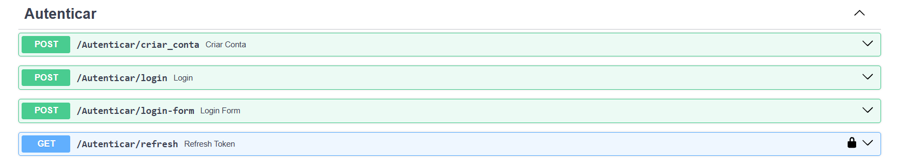
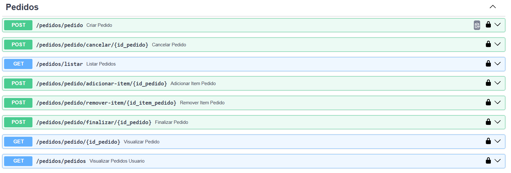

# FastAPI Project — API de Pedidos

API em FastAPI desenvolvida durante o curso: cadastro de usuários e base para um sistema de pedidos (pizzaria), com banco SQLite gerenciado por SQLAlchemy e migrações via Alembic.

## O que foi implementado até agora

### Estrutura

| Arquivo | Função |
|---|---|
| `main.py` | Cria o app FastAPI e registra os routers. |
| `config.py` | Carrega o `.env` (`SECRET_KEY`, `ALGORITHM`, `ACCESS_TOKEN_EXPIRE_MINUTES`), configura o `bcrypt_context` (hash de senhas) e o `oauth2_schema`. |
| `models.py` | Modelos do banco (SQLAlchemy) e conexão com `sqlite:///banco.db`. |
| `schemas.py` | Schemas Pydantic de validação das requisições e respostas. |
| `dependencies.py` | `pegar_sessao()` abre e fecha a sessão do banco; `verificar_token()` / `verificar_refresh_token()` validam o JWT e devolvem o usuário. |
| `auth_routes.py` | Rotas de autenticação/cadastro (`/Autenticar`). |
| `order_routes.py` | Rotas de pedidos (`/pedidos`). |
| `test_api.py` | Testes das rotas (banco em memória, não toca no `banco.db`). |
| `alembic/` + `alembic.ini` | Migrações do banco. |

### Banco de dados (tabelas)

- **usuarios**: `id`, `nome`, `email` (único), `senha` (hash bcrypt), `ativo`, `admin`
- **pedidos**: `id`, `status` (padrão `Pendente`), `usuario_id` → usuarios, `preco`
- **itens_pedido**: `id`, `quantidade`, `sabor`, `tamanho`, `preco`, `pedido_id` → pedidos

### Rotas

#### Autenticar (`/Autenticar`)



| Método | Rota | Descrição |
|---|---|---|
| POST | `/Autenticar/criar_conta` | Cria um usuário comum (ativo, não admin). Erro 400 se o e-mail já existir. |
| POST | `/Autenticar/login` | Login com JSON; devolve `access_token` e `refresh_token` (7 dias). |
| POST | `/Autenticar/login-form` | Mesmo login, via formulário (usado pelo botão Authorize do Swagger). |
| GET | `/Autenticar/refresh` | Recebe o **refresh token** e devolve um novo access token. |

Exemplo de corpo para `/Autenticar/criar_conta`:

```json
{
  "nome": "Fulano",
  "email": "fulano@exemplo.com",
  "senha": "minhasenha"
}
```

#### Pedidos (`/pedidos`)



| Método | Rota | Descrição |
|---|---|---|
| POST | `/pedidos/pedido` | Cria um pedido (só para si mesmo, ou para qualquer um se admin). Corpo: `{"id_usuario": 1}`. |
| POST | `/pedidos/pedido/cancelar/{id_pedido}` | Muda o status para `Cancelado` e devolve o pedido. |
| GET | `/pedidos/listar` | Lista todos os pedidos (só admin). |
| POST | `/pedidos/pedido/adicionar-item/{id_pedido}` | Adiciona item e recalcula o preço. Devolve `item_id` e `pedido_preco`. |
| POST | `/pedidos/pedido/remover-item/{id_item_pedido}` | Remove item e recalcula o preço. Devolve `quantidade_itens_pedido` e `pedido_preco`. |
| POST | `/pedidos/pedido/finalizar/{id_pedido}` | Muda o status para `Finalizado` e devolve o pedido. |
| GET | `/pedidos/pedido/{id_pedido}` | Mostra um pedido com seus itens (`id`, `status`, `preco`, `itens`). |
| GET | `/pedidos/pedidos` | Lista os pedidos do usuário logado, cada um com seus itens. |

Regras:

- Todas as rotas de `/pedidos` exigem o access token (cadeado no Swagger).
- Usuário comum só acessa os próprios pedidos; admin acessa todos. Caso contrário: **401**.
- Pedido ou item inexistente: **404**.
- Só pedidos `Pendente` aceitam adicionar/remover itens ou ser finalizados; senão: **400**.
- Admin não é definido pela API: mude a coluna `admin` direto no banco.

Exemplo de corpo para `/pedidos/pedido/adicionar-item/{id_pedido}` (`quantidade` e `preco` precisam ser > 0):

```json
{
  "quantidade": 2,
  "sabor": "Calabresa",
  "tamanho": "Grande",
  "preco": 45.0
}
```

## Como rodar (Windows / PowerShell)

### 1. Criar e ativar o ambiente virtual

```powershell
python -m venv .venv
.\.venv\Scripts\Activate.ps1
```

> Se o PowerShell bloquear o script de ativação, rode uma vez:
> `Set-ExecutionPolicy -Scope CurrentUser RemoteSigned`

### 2. Instalar as dependências

```powershell
pip install -r requirements.txt
```

### 3. Criar o arquivo `.env`

Crie um arquivo `.env` na raiz com as variáveis abaixo (ele está no `.gitignore` e **não** deve ser commitado). As três são obrigatórias: sem elas a API não sobe.

```
SECRET_KEY=coloque_uma_chave_aleatoria_aqui
ALGORITHM=HS256
ACCESS_TOKEN_EXPIRE_MINUTES=30
```

Para gerar uma chave aleatória:

```powershell
python -c "import secrets; print(secrets.token_hex(32))"
```

### 4. Criar/atualizar o banco de dados (Alembic)

```powershell
alembic upgrade head
```

Quando alterar algo em `models.py`, gere uma nova migração e aplique:

```powershell
alembic revision --autogenerate -m "descricao da mudanca"
alembic upgrade head
```

### 5. Subir o servidor

```powershell
uvicorn main:app --reload
```

Se a porta 8000 estiver ocupada: `uvicorn main:app --reload --port 8001`

### 6. Acessar a documentação

- Swagger: http://127.0.0.1:8000/docs
- ReDoc: http://127.0.0.1:8000/redoc

Para parar o servidor: `Ctrl + C`.

### 7. Rodar os testes

```powershell
python -m pytest
```
